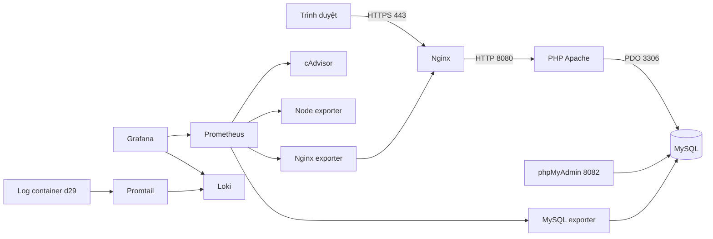

# Đề 29 - Website công thức nấu ăn

MSSV **DTC245220017**. Repository public: [DTC245220017-Website-Cong-thuc-Nau-an](https://github.com/longphan632000/DTC245220017-Website-Cong-thuc-Nau-an). Theo lựa chọn của sinh viên, giữ tài khoản GitHub `longphan632000`; tên repository có MSSV. Báo cáo in và bìa do sinh viên tự làm, không đưa vào Git.

Website Bếp Nhà dùng PHP/PDO thuần và MySQL, triển khai bằng Docker Compose. Admin tạo và chia sẻ công thức; khách xem, tìm món, lọc danh mục và bình luận. Cấu trúc dựa trên [repository mẫu được chỉ định](https://github.com/Khanhslee/DTC245220024_De7-Blog-CMS/tree/68978cd2eb0872ea14261810d7c64299ef8ffcec), kết hợp kiến thức chương 2–9 trong giáo trình đã cung cấp.

## Khởi động trên máy mới

Cần Docker Engine, Docker Compose và OpenSSL. Không cần cài PHP/MySQL trên host.

```bash
git clone https://github.com/longphan632000/DTC245220017-Website-Cong-thuc-Nau-an.git
cd DTC245220017-Website-Cong-thuc-Nau-an
bash scripts/tao-mat-khau.sh
mkdir -p nginx/certs
openssl req -x509 -nodes -days 365 -newkey rsa:2048 \
  -keyout nginx/certs/nginx.key -out nginx/certs/nginx.crt \
  -subj "/C=VN/ST=ThaiNguyen/L=ThaiNguyen/O=ICTU/OU=ATTT/CN=localhost" \
  -addext "subjectAltName=DNS:localhost,IP:127.0.0.1"
docker compose up -d --build
docker compose ps
```

Script tạo **6 mật khẩu khác nhau**, mỗi mật khẩu 39 ký tự, có chữ hoa/thường, số và ký tự đặc biệt, với phần ngẫu nhiên 128 bit. Mật khẩu thật lưu trong `.env` và **`TAI_KHOAN_LOCAL.txt`**, cả hai có quyền `600` và được Git ignore. Hash đăng nhập admin được tạo bằng PHP trong container; mật khẩu/hash thật không nằm trong cấu hình public. `.env.example` chỉ liệt kê các biến, không có mật khẩu mặc định dùng được. Script từ chối ghi đè các file đang tồn tại.

**Trên máy hiện tại đã có `.env`, chứng chỉ và dữ liệu:** chỉ chạy `docker compose up -d --build`. Các mật khẩu cũ đã được đổi trực tiếp trong DB/Grafana, không chỉ sửa biến môi trường. Không xóa `.env`, không chạy script tạo mật khẩu lại để sửa lỗi đăng nhập.

## Truy cập và phân quyền

Mở file **`TAI_KHOAN_LOCAL.txt` trên máy của bạn** để lấy mật khẩu tương ứng. Admin website, Grafana và MySQL dùng mật khẩu khác nhau.

| Dịch vụ | Địa chỉ | Tài khoản |
| --- | --- | --- |
| Trang người dùng | https://localhost | Không cần đăng nhập; chỉ xem và bình luận |
| Trang quản trị | https://localhost/admin.php | `admin`, mật khẩu mục Admin website |
| phpMyAdmin | http://localhost:8082 | `root` quản trị, `recipe_user` thao tác dữ liệu, `report_user` chỉ đọc |
| Grafana | http://localhost:3000 | `admin`, mật khẩu mục Grafana |
| Prometheus targets | http://localhost:9090/targets | Giao diện kiểm tra target |
| cAdvisor | http://localhost:8081 | Giám sát tài nguyên container |
| Loki readiness | http://localhost:3100/ready | API; truy vấn log bằng Grafana |

Người dùng mở chi tiết một món, nhập tên và bình luận. Trang công khai không có biểu mẫu thêm/sửa/xóa công thức hay danh mục. Admin có trang đăng nhập riêng để tạo/chia sẻ, sửa/xóa công thức, thêm danh mục và xóa bình luận không phù hợp. PHP kiểm tra session và role từ DB trước mọi thao tác quản trị; gửi POST giả mạo từ khách bị trả `403`.

Ứng dụng đổi session ID khi đăng nhập/đăng xuất, hết phiên sau 30 phút không hoạt động; cookie có HttpOnly/SameSite và cờ Secure khi đi qua HTTPS. Các biểu mẫu POST dùng CSRF; SQL dùng tham số PDO; tên/nội dung được escape khi hiển thị. Tác giả công thức mới lấy từ admin đã xác thực, không lấy từ `user_id` client gửi.

Database `recipe_db` có 4 bảng `users`, `categories`, `recipes`, `comments`; dữ liệu khởi tạo có 6 món, 6 danh mục, 2 tác giả dữ liệu và 1 tài khoản admin. `daubep`/`thanhvien` là dữ liệu tác giả, không phải tài khoản đăng nhập. Xóa món sẽ xóa bình luận liên quan qua khóa ngoại `ON DELETE CASCADE`.

## Kiến trúc và Compose



12 service trong `docker-compose.yml` dùng ba bridge network:

| Mạng | Thành phần |
| --- | --- |
| frontend-net | Nginx, recipe-app |
| backend-net | recipe-app, MySQL, phpMyAdmin, MySQL exporter |
| monitoring-net | Nginx, MySQL exporter, Prometheus, Grafana, cAdvisor, node-exporter, nginx-exporter, Loki, Promtail |

MySQL, ứng dụng và Promtail không publish cổng host. MySQL chỉ ở mạng backend; Prometheus/Grafana không kết nối trực tiếp vào mạng DB. Đây là phân đoạn mạng, chưa dùng `internal: true` để chặn toàn bộ egress.

Named volume `mysql_data`, `prometheus_data`, `grafana_data`, `loki_data` giữ dữ liệu. Cổng theo mẫu: Nginx 80/443, Grafana 3000, Loki 3100, cAdvisor 8081, phpMyAdmin 8082, Prometheus 9090; exporter 9100/9104/9113. Các stack khác trên máy đã dừng, giữ dữ liệu của chúng.

## Nginx reverse proxy và HTTPS

Nginx chuyển HTTP sang HTTPS, kết thúc TLS rồi proxy đến `recipe-app:8080`. Chứng chỉ tự ký dùng cho localhost có SAN; trình duyệt có thể cảnh báo chưa tin cậy. Kiểm tra bằng đúng chứng chỉ lab:

```bash
curl -I http://localhost
curl --cacert nginx/certs/nginx.crt -I https://localhost
docker compose exec nginx nginx -t
```

Kết quả: HTTP 301 chuyển hướng; HTTPS 200; `X-Frame-Options: SAMEORIGIN`, `X-Content-Type-Options: nosniff`, `Referrer-Policy: strict-origin-when-cross-origin`; TLS 1.2/1.3, `server_tokens off`. Cấu hình mẫu còn có `X-XSS-Protection`, không xem header cũ này thay cho escape HTML/kiểm tra đầu vào.

## Giám sát bằng Prometheus và Grafana

Prometheus scrape mỗi 15 giây, với năm job: prometheus, node-exporter, cadvisor, mysql, nginx. Kiểm tra http://localhost:9090/targets: cả năm phải UP. `mysql_up=1` và `nginx_up=1` xác nhận exporter kết nối được dịch vụ đích.

Grafana → Connections → Data sources → Add data source → Prometheus, URL **`http://prometheus:9090`** → Save & test. Sau đó Dashboards → New → Import → chọn `grafana/dashboards/de29.json` → chọn datasource Prometheus → Import. Trên máy hiện tại đã có dashboard; các dashboard khác được giữ lại.

Bảy panel dùng các query sau; hai `_up` dùng Stat, các query còn lại dùng Time series:

```promql
nginx_up
mysql_up
rate(nginx_http_requests_total[1m])
mysql_global_status_threads_connected
rate(mysql_global_status_queries[1m])
rate(container_cpu_usage_seconds_total{container_label_com_docker_compose_project="d29"}[5m]) * 100
container_memory_usage_bytes{container_label_com_docker_compose_project="d29"}
```

cAdvisor thu tài nguyên container; MySQL/Nginx exporter cung cấp metrics DB/web. Cửa sổ CPU 5 phút phù hợp chu kỳ housekeeping 30 giây của cAdvisor. CPU thể hiện mức sử dụng lõi, không phải phần trăm đã chuẩn hóa theo số lõi của toàn máy. node-exporter theo cấu hình mẫu chưa mount host rootfs, nên không khẳng định dashboard bao phủ đầy đủ OS host. Chưa cấu hình cảnh báo tự động.

`prometheus/.my.cnf` giữ host/user/port, **không chứa password**. Password exporter lấy từ `.env` qua `MYSQLD_EXPORTER_PASSWORD`, là cơ chế được [mysqld_exporter hỗ trợ](https://github.com/prometheus/mysqld_exporter#environment-variables).

## Log tập trung bằng Loki và Promtail

Promtail phát hiện container có label project `d29`, gắn label `container`/`service`, đẩy log đến Loki. Grafana → Connections → Data sources → Add data source → Loki, URL **`http://loki:3100`** → Save & test. Import `grafana/dashboards/de29-logs.json`, chọn datasource Loki. Hai file JSON có lựa chọn datasource trong bước Import; không phụ thuộc UID của máy cũ. Có thể tự tạo panel theo phần thực hành chương 8.

Explore → Loki → Code → chạy ít nhất ba query; dưới đây có bốn query đã kiểm tra:

```logql
{container="d29-recipe-app"}
{container="d29-recipe-app"} |~ "GET|POST"
{container="d29-mysql"}
{container="d29-nginx"} |= "404"
```

`|~` lọc regex, `|=` lọc chuỗi. Query 404 là phép lọc chuỗi cơ bản, chưa parse trường HTTP status. Tạo log mới:

```bash
curl --cacert nginx/certs/nginx.crt 'https://localhost/?id=999999'
docker compose logs --tail=30 promtail
docker compose logs --tail=30 loki
```

Chọn Last 24 hours để thấy log khởi động MySQL; MySQL không bật general query log nên không phải mọi SELECT/UPDATE đều xuất hiện. Dashboard Logs có ba panel ứng dụng, MySQL và Nginx 404. Loki lưu trên volume; file positions của Promtail theo mẫu nằm ở `/tmp`, chưa có volume riêng.

## Các biện pháp hardening và cách chứng minh

| Biện pháp | Cấu hình và kiểm tra |
| --- | --- |
| Non-root ứng dụng | Dockerfile `USER www-data`; `id` trả UID 33 |
| Hạn chế quyền container | `cap_drop: ALL`, `no-new-privileges`; CapBnd bằng 0 và NoNewPrivs bằng 1 |
| Phân đoạn mạng | Ba mạng riêng; MySQL không publish 3306; kiểm tra thành viên bằng `docker network inspect` |
| Mật khẩu mạnh | Sáu mật khẩu khác nhau sinh ngẫu nhiên, không dùng lại mật khẩu lab cũ; `.env`/file tài khoản quyền 600, không commit |
| Hạn chế quyền DB | App chỉ SELECT/INSERT/UPDATE/DELETE; report_user chỉ SELECT; exporter dùng tài khoản riêng, tối đa 3 kết nối |
| Reverse proxy | HTTPS/TLS, security headers và ẩn phiên bản Nginx |
| Phân quyền ứng dụng | Admin xác thực, CSRF, PDO tham số, escape HTML, cookie phiên |

```bash
docker compose exec recipe-app id
docker compose exec recipe-app sh -c 'sed -n "/^CapBnd:/p;/^NoNewPrivs:/p" /proc/1/status'
docker network inspect d29_backend-net
docker compose exec recipe-app getent hosts mysql
docker compose exec mysql mysql -uroot -p
```

Nhập mật khẩu root trong file tài khoản khi MySQL hỏi. Trong MySQL hoặc phpMyAdmin → SQL:

```sql
SHOW GRANTS FOR 'recipe_user'@'%';
SHOW GRANTS FOR 'report_user'@'%';
SHOW GRANTS FOR 'exporter_user'@'%';
SELECT title, ingredients, instructions FROM recipe_db.recipes;
```

Đăng nhập bằng `recipe_user`, thử CREATE TABLE phải bị ERROR 1142. Đăng nhập bằng `report_user`, thử `DELETE FROM recipe_db.recipes WHERE id=-1;` cũng bị từ chối. Điều kiện id=-1 tránh tác động dữ liệu nếu quyền cấu hình sai.

Các cổng quản trị vẫn publish theo mô hình thực hành; Prometheus/Loki chưa có xác thực riêng, Docker socket của Promtail có quyền truy cập Docker API, vì vậy không coi đây là cấu hình production. App không nhận mật khẩu root, report_user hay Grafana qua environment.

## SQL khởi tạo, nâng cấp và dữ liệu

`mysql/init.sql` tạo schema và dữ liệu mẫu; Compose mount thành `01-schema.sql`. `mysql/02-users.sh` chạy sau đó, đọc mật khẩu/hash từ environment để thực hiện CREATE USER, ALTER USER, GRANT/REVOKE và tạo admin website. Chỉ các tài khoản DB cần thiết được truyền vào service MySQL; không đưa tất cả `.env` vào mọi container.

Với volume cũ thiếu bảng comments/cột hash, áp dụng `mysql/upgrade-admin-comments.sql` bằng root để nâng cấp schema. File này không có mật khẩu cố định. Trên máy hiện tại đã nâng cấp và đồng bộ mật khẩu xong. Với DB/Grafana đã có dữ liệu, sửa `.env` không tự đổi mật khẩu trong DB; phải dùng ALTER USER/công cụ quản trị của dịch vụ và cập nhật các thành phần phụ thuộc cùng lúc. [Grafana CLI](https://grafana.com/docs/grafana/latest/administration/cli/) hỗ trợ reset password từ stdin.

```bash
# Dừng và giữ dữ liệu
docker compose down
# Chạy lại
docker compose up -d
# Kiểm tra cấu hình
docker compose config --quiet
```

Không dùng `docker compose down -v` chỉ để sửa cấu hình: tùy chọn này xóa các volume. Sao lưu bằng phpMyAdmin Export trước khi thay đổi DB; Import đúng database khi phục hồi.

## Kịch bản demo theo tiêu chí

1. Mở GitHub và `git log --oneline --reverse`: source/config/README, ba mốc triển khai ban đầu và commit bổ sung.
2. Mở website, tìm gừng, lọc Món canh, bình luận; đăng nhập admin, tạo/sửa/xóa món tạm; kiểm tra khách không có quyền quản trị.
3. Mở phpMyAdmin, đối chiếu 4 bảng và dữ liệu; dùng SHOW GRANTS, thử thao tác vượt quyền phải bị từ chối.
4. Chạy curl chứng minh HTTP 301, HTTPS 200, security headers và nginx -t.
5. Mở Prometheus targets và Grafana: container CPU/RAM, Nginx requests, MySQL connections/queries; giải thích up và mysql_up/nginx_up.
6. Chạy ít nhất 3 LogQL; tạo request 404 và tìm dòng log tương ứng, chọn khoảng thời gian phù hợp.
7. Chạy id, xem network, CapBnd/NoNewPrivs và quyền DB để chứng minh hardening. Không hiển thị file tài khoản trong ảnh/báo cáo public.

Ảnh trong `minh-chung/` lấy từ hệ thống thực tế; website được chụp qua HTTP nội bộ container do trình duyệt tự động không tin chứng chỉ tự ký. HTTPS được kiểm chứng riêng bằng CA lab, không bỏ qua xác thực chứng chỉ. Kết quả cuối cùng xem `minh-chung/kiem-tra-tieu-chi.txt`; các kết quả cũ còn giữ để đối chiếu lịch sử.

## Đối chiếu với yêu cầu và giáo trình

| Tiêu chí | Phần triển khai và nguồn học |
| --- | --- |
| GitHub | Repository public, tên có MSSV, source/config và README; chương 4; có đủ ba mốc commit yêu cầu |
| Ứng dụng + DB | PHP/PDO, MySQL, phpMyAdmin; Dockerfile/Compose/volume theo chương 2–3, tài khoản/quyền DB theo chương 6 |
| Nginx | Reverse proxy, HTTPS tự ký, headers; chương 5 |
| Prometheus + Grafana | 5 job, metrics container/web/DB, dashboard; chương 7 |
| Loki + Promtail | Log tập trung, dashboard và 4 LogQL; chương 8 |
| Hardening | Non-root, giảm quyền, mật khẩu mạnh, network, quyền DB và headers; nguyên tắc chương 9 |
| Tổng thể và trình bày | 12 service Compose, ảnh thật, kết quả kiểm tra, kịch bản demo; sinh viên cần tự trình bày và giải thích |
| Báo cáo tối thiểu 10 trang + bìa | Sinh viên tự làm tài liệu riêng để in, không đưa lên Git theo yêu cầu |

Giữ cách tổ chức mẫu: `app/`, `mysql/`, `nginx/`, `prometheus/`, `loki/`, `promtail/`; bổ sung `grafana/dashboards/` để import và `scripts/tao-mat-khau.sh` để khởi tạo thông tin riêng. Không thêm framework ứng dụng. Dockerfile app, prometheus.yml và loki-config.yml giữ nguyên mẫu; SQL cấp quyền vẫn dùng các lệnh của chương 6, mật khẩu được tách sang `.env` theo cách quản lý biến môi trường chương 3.
